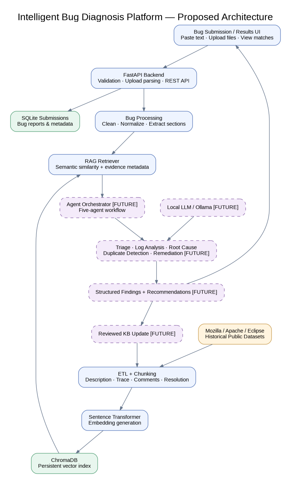

# BugLens — Intelligent Bug Diagnosis Platform (Milestone 1)

A local, GitHub-ready prototype for bug report submission, historical issue ingestion and semantic retrieval. **M1 implements foundation and retrieval, not an LLM-generated bug diagnosis or agent orchestration.**



## Tech stack
Python 3.11+, FastAPI, HTML/CSS/JavaScript, SQLite, Sentence Transformers (`all-MiniLM-L6-v2`), ChromaDB. Ollama and LangGraph are future milestones, not dependencies yet.

## Quick start (Windows PowerShell)

```powershell
cd intelligent-bug-diagnosis
py -3.11 -m venv .venv
.\.venv\Scripts\Activate.ps1
python -m pip install -r requirements.txt
python scripts/ingest.py data/demo_synthetic_defects.csv --source Demo
python -m uvicorn app.main:app --reload
```

Open http://127.0.0.1:8000 . The first indexing run downloads the sentence-transformer model (internet needed once, approximately 90 MB for the model weights; installed dependencies take additional space). If you use Python 3.12, replace `py -3.11` with `py -3.12`. **Run these commands from the project root.**

For macOS/Linux:

```bash
python3 -m venv .venv
source .venv/bin/activate
pip install -r requirements.txt
python scripts/ingest.py data/demo_synthetic_defects.csv --source Demo
uvicorn app.main:app --reload
```

## Try a retrieval query
Paste `Database connection pool timeout after restarting MySQL` in the **Search historical defects** panel. The synthetic example `DEMO-002` is intended to be relevant; actual scores depend on the embedding model. To save a report, add title, description or logs and click **Save bug report**. Verify persistence through `GET /api/bugs/{id}` or `/docs`.

## Import actual historical bugs (required for full M1.4)
1. Download appropriately licensed public issue CSV/JSON/JSONL files for **Mozilla, Apache and Eclipse** from Kaggle, official trackers or curated exports; record provenance in `docs/dataset_manifest.md`.
2. Inspect each file's columns and standardize to `source,bug_id,title,description,stack_trace,comments,resolution,status,url` (missing fields are allowed). The importer also recognizes common aliases like `summary`, `bugid`, `issue_key`, and `short_desc`.
3. Run each import from the root, e.g.:

```powershell
python scripts/ingest.py path/to/mozilla.csv --source Mozilla
python scripts/ingest.py path/to/apache.csv --source Apache
python scripts/ingest.py path/to/eclipse.csv --source Eclipse
```

4. Search examples from each project. The index persists under `data/chroma/` and is intentionally ignored by Git. To change embedding model, delete/recreate the local vector index; mixing dimensions/models breaks retrieval consistency.

**Dataset caveat:** The archive contains synthetic data only; downloading and verifying actual public datasets remains a required user step. The parser is a starter, not a universal Jira/Bugzilla converter (e.g. deeply nested API JSON or comment histories may need a transformation script).

## API endpoints
- `GET /` — Web UI
- `GET /api/health` — Liveness
- `POST /api/bugs` — multipart form fields `title`, `description`, `stack_trace`, `error_logs`, optional `file` (`.txt`, `.log`, `.json`, `.csv`, `.md`, ≤2 MB)
- `GET /api/bugs/{id}` — Read stored report
- `POST /api/search` — JSON `{"query":"login null pointer", "top_k":5}`
- `GET /docs` — OpenAPI interactive API documentation

## Tests

```powershell
python -m pip install pytest
python -m pytest -q
```

## Milestone checklist
- [x] M1.1 Research and approach documented in `docs/research_and_design.md`
- [x] M1.2 Architecture diagram, flow, agent contracts, data schemas
- [x] M1.3 Web interface, direct paste, optional file upload, validation, SQLite persistence
- [x] M1.4 Normalization, chunking, embedding generation, Chroma indexing, semantic retrieval implementation
- [ ] M1.4 Import and verify genuine Mozilla, Apache and Eclipse data; record counts and source links
- [ ] Run on target machine; capture test screenshots and push to GitHub

## Repository layout

```text
app/         FastAPI endpoints, data & vector utilities, web UI
scripts/     CSV/JSON/JSONL normalization + ingestion
data/        Synthetic smoke-test CSV (database & vector index ignored)
docs/        Architecture diagram, research, source manifest
tests/       Unit tests for preprocessing and mapping
```

## Known limitations & future work
- Five agents and LLM are **architecture-only** in M1. Later implement orchestrator, agent I/O schemas and grounded recommendations.
- Similarity score is cosine similarity, not a calibrated duplicate probability.
- No authentication, rate limits, provenance verification, upload malware scanning, production encryption or redaction yet. **Use local non-sensitive data only.**
- Chunks are character-based and stack traces are kept as their own section; token-aware segmentation is a future improvement.
- Retrieval currently returns strongest matching chunk per historical bug; add reranking, hybrid keyword search and source filters later.

## Sources
- https://fastapi.tiangolo.com/tutorial/request-files/
- https://cookbook.chromadb.dev/core/collections/
- https://wiki.mozilla.org/Bugzilla:REST_API
