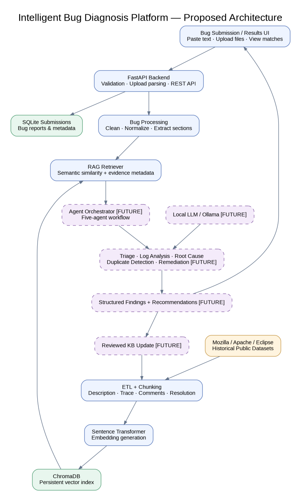

# M1.1 — Research and Technical Understanding

## 1. Software defect analysis workflow
A traditional issue lifecycle is: report → validate/reproduce → classify (product, component, severity, priority) → inspect logs/trace → search similar issues → identify probable cause → propose repair → verify via tests → close/document. Historical resolutions can guide debugging but must not be treated as proof that a particular fix will work.

## 2. Retrieval-Augmented Generation (RAG)
**Ingestion:** load historical issues; normalize fields; split descriptions, traces, comments and resolutions; embed chunks; save vectors and metadata. **At query time:** validate submitted issue; construct textual query; embed; search nearest-neighbor vectors; deduplicate results by issue; provide passages with issue references. **Later milestones:** ground a local LLM and agents on retrieved passages, with citations and uncertainty indicators.

RAG differs from model fine-tuning: retrieval changes the evidence shown at query time without updating model weights. This milestone implements retrieval only; it does not assert generated diagnoses.

## 3. Embeddings and semantic similarity
Sentence Transformers map text into numerical vectors. This project uses `sentence-transformers/all-MiniLM-L6-v2` for a lightweight local proof of concept. Chroma collections are configured for cosine distance, and query embeddings are generated by the *same model* used for indexing. The displayed similarity `1 - cosine_distance` is a **ranking indicator**, not a calibrated probability or definitive duplicate verdict. Character-level chunking is a pragmatic initial approach; later versions should add token-aware and stack-frame-aware boundaries.

## 4. Public dataset analysis and source mapping
Import downloaded **public** data from Mozilla/Bugzilla, Apache/Jira and Eclipse/Bugzilla or selected Kaggle datasets. Actual file schemas vary: inspect headers and configure mapping before ingestion. Current importer recognizes common aliases but does not promise universal coverage. Verify download rights, attribution, and redistribution terms; do not commit private or secret-bearing bug reports.

| Canonical field | Typical Bugzilla | Typical Jira |
|---|---|---|
| bug_id | bug_id / bugid / id | issue_key / key / id |
| title | summary / short_desc | summary |
| description | description | description |
| stack_trace | extracted from description/comments | extracted from description/comments |
| comments | comments | comments |
| resolution | resolution | resolution |
| status | status | status |
| url | source bug URL | issue URL |

Official Mozilla REST API documentation: https://wiki.mozilla.org/Bugzilla:REST_API ; an example public bug endpoint is https://bugzilla.mozilla.org/rest/bug/35 . Dataset discovery is **not** equivalent to downloading a Kaggle dataset. Record each dataset's author, URL, license, extraction date and number of records in `docs/dataset_manifest.md`.

## 5. Proposed evaluation
Create a manually verified query set with known related defects. Evaluate Recall@5 and MRR@5 (relevance of retrieved issue IDs), average search latency, and duplicate false positives. Split evaluation data by issue or project to reduce leakage. Test stack trace preservation, uploads, invalid file types, size limits, and malformed datasets.

# M1.2 — Architecture and Design

## Agent responsibilities (future implementation)
| Agent | Input | Output |
|---|---|---|
| Triage | title, reproduction steps, environment | category, affected component, urgency suggestions |
| Log Analysis | trace, time-stamped errors | exceptional frames, failure signatures, extracted evidence |
| Root Cause | logs + retrieval evidence | ranked cause hypotheses with traceable supporting passages |
| Duplicate Detection | report + similar issue IDs | likely duplicates, reasons, confidence caveats |
| Remediation | root-cause hypotheses + prior fixes | proposed fix steps, regression-test suggestions, risk notes |

## Orchestration sequence
1. `POST /api/bugs`: validate text/file; persist report to SQLite; return report ID.
2. User requests semantic search with report description or stack trace.
3. Retriever embeds query and finds historically similar chunks in Chroma; returns one best chunk per issue.
4. **Later:** orchestrator passes report and evidence to triage and log agents; root-cause and duplicate agents; remediation agent; combines into evidence-backed findings.
5. **Later:** human reviews any fix, and only accepted outcomes enter the historical KB update process (prevent poisoning/feedback loops).

## Data model
### Submission in SQLite
`id` (integer PK), `title` (text), `description` (text), `stack_trace` (text), `error_logs` (text), `filename` (optional text), `created_at` (ISO timestamp).

### Normalized historical issue (import records)
`source`, `bug_id`, `title`, `description`, `stack_trace`, `comments`, `resolution`, `status`, `url`.

### Chroma chunk
`id = source:bug_id:section:index`; `document = section + text`; metadata: `source`, `bug_id`, `section`, `title`, `status`, `resolution`, `url`. Each source issue may create multiple chunks. The returned search results are deduplicated by `(source, bug_id)`.

## Security and scope limitations
Prototype is intended for local study, not production deployment. It has no authentication or rate limiting. Use non-sensitive public or synthetic data; reports may contain passwords, tokens, PII or proprietary source code, and must be redacted before ingestion. File content must be UTF-8, accepted extensions only, size ≤2 MB. Files are decoded and appended to stored error text; raw files are **not** persisted. Preserve historical record IDs for attribution and traceability. No direct execution of uploaded logs.

## References
- FastAPI file upload guide: https://fastapi.tiangolo.com/tutorial/request-files/
- Chroma collections: https://cookbook.chromadb.dev/core/collections/
- Chroma distances and embedding dimensions: https://cookbook.chromadb.dev/faq/
- Mozilla REST API: https://wiki.mozilla.org/Bugzilla:REST_API
